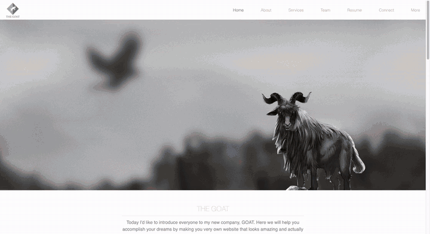

# The Goat

A multi-page portfolio and business website for "The Goat", a small web design and development agency I started. It has a home page with parallax scrolling, an about page with a background video, services, team, resume and contact pages, and a "coming soon" page with a countdown. It is built with HTML, CSS, JavaScript, jQuery and Bootstrap, with PHP for shared page parts and the contact forms.



▶️ **[Watch the full demo video](https://sangye-tenphel.s3.amazonaws.com/theGoat.mp4)** (1 minute 11 seconds)

## Features

- **Parallax home page:** as you scroll, the bird, goat logo and background layers move at different speeds, the nine image tiles fade in one after another, a "from $99" promo banner slides its background, and the project cards slide in from the sides.
- **Scroll animations:** headings, text and the navigation fade in with ScrollReveal.
- **About page:** a full-screen looping background video, smooth scrolling to the next section, a collapsible "Life of a programmer" section with embedded GIPHY GIFs, and team member cards.
- **Services page:** full-width parallax image sections for "What we do", "Design" and "Development".
- **Team page:** a split screen ("The Designer" and "The Programmer") where the side under the mouse grows to 75% of the width.
- **Resume page:** skills, work experience and education, with a button to download the resume as a PDF.
- **Contact forms:** the Connect page opens a Bootstrap modal form (name, email, message), and the designer's profile page has its own form. Both send the message as an HTML email with PHP's `mail()` function.
- **Coming soon page:** a countdown in days, hours, minutes and seconds that switches to "Launched!" when the date passes. The date is set to January 1, 2020, so it now shows "Launched!".
- **Responsive navigation:** a CSS-only menu that collapses into a hamburger button on small screens.

## How it works

Each page is a PHP file. `header.php` holds the shared `<head>` content (stylesheets, scripts and icon) and `footer.php` holds the shared footer, and every page includes both with `include_once`. Apart from that, the pages are static HTML.

`js/functions.js` handles the home page parallax effect (it moves elements based on the scroll position), the countdown on the More page and the hover effect on the Team page. `css/style.css` contains the styles for all pages.

When a contact form is submitted, the same page reads the posted name, email and message, builds an HTML email, and sends it with `mail()`. A browser alert confirms when the message was sent.

## Project structure

```
index.php           Home page (parallax header, image tiles, promo banner, projects)
about.php           About me, team cards and "Life of a programmer" GIFs
services.php        What we do, design and development
team.php            Split-screen designer / programmer page
resume.php          Skills, experience, education and resume download
connect.php         Contact cards and the modal contact form
sonam-tenzi.php     Profile page for the agency's graphic designer, with a contact form
more.php            Coming soon page with the countdown
header.php          Shared <head>: Bootstrap, Skeleton, jQuery, Font Awesome, ScrollReveal
footer.php          Shared footer (contact details, hours, service area)
css/style.css       Styles for all pages
js/functions.js     Parallax scrolling, countdown and team page hover
img/, video/        Images and background videos
resume/             Resume as PDF and Word document
```

## Running it locally

You need PHP (any recent version; tested with PHP 8.3). PHP's built-in web server is enough:

```bash
git clone https://github.com/sangyetenphel/the-goat.git
cd the-goat
php -S localhost:8000
```

Then open http://localhost:8000/index.php. The libraries (Bootstrap, jQuery, Font Awesome, ScrollReveal) and the Google font load from CDNs, so the pages need an internet connection to look right. The contact forms only send email on a server where PHP's `mail()` is set up; on the built-in server they do nothing.

## Built with

- **Frontend:** HTML5, CSS3, JavaScript, jQuery, [Bootstrap 4](https://getbootstrap.com/), the Skeleton grid, Font Awesome and ScrollReveal
- **Backend:** PHP (shared page includes and the contact forms)

The site used to be online at its own domain, but that deployment no longer exists. The "Alpine Lodge" project card on the home page now links to the [project's GitHub repository](https://github.com/sangyetenphel/alpine-lodge) instead of its old, offline website.

Created by Sangye Tenphel, 2019.
